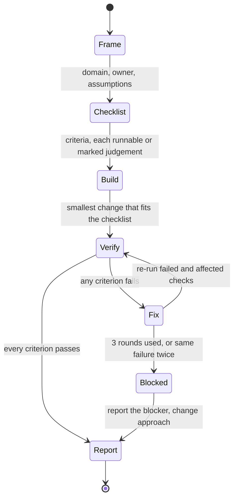

# expert-loop

A Claude Code skill that makes the model write a runnable checklist for your task,
build against it, and report only what real checks confirmed.

## Install

For all your projects, as a plugin:

```bash
claude plugin marketplace add radeshgovind-2005/expert-loop
claude plugin install expert-loop@expert-loop
```

Or copy the skill by hand:

```bash
cp -r skills/expert-loop ~/.claude/skills/
```

## Use

Say "expert loop" before a task, or invoke `/expert-loop`.

An illustrative run (not a recorded one):

```text
You:    expert loop: add a NOT NULL "region" column to the 50M-row orders table

Frame:  Domain: PostgreSQL schema migration. Owner: a senior DBA who optimises
        for no downtime and accepts a slower rollout.
```

The checklist it writes. Each item is runnable, or marked `judgement`:

| # | Criterion | Check |
|---|-----------|-------|
| 1 | Migration applies cleanly | `psql -f up.sql` on a schema copy exits 0 |
| 2 | Rollback restores the schema | run `down.sql`, diff the schema dump |
| 3 | No long write lock on `orders` | `judgement` |

The report it ends with:

| # | Status | Evidence |
|---|--------|----------|
| 1 | pass | exit 0 |
| 2 | pass | schema diff is empty |
| 3 | unverified | no staging copy at scale, so lock time was not measured |

The report also lists the assumptions made and the open risks.

## How it works

Each state has one job. Only a real check result moves the loop from Verify to Report.
A fix round is limited: at most 3 rounds, and the same failure twice stops the loop.



The full rules are in [`skills/expert-loop/SKILL.md`](skills/expert-loop/SKILL.md).

## When not to use it

- Trivial questions and one-line edits. The loop is overhead there. The skill
  collapses Frame and Checklist into two lines for small tasks.
- Tasks with nothing to check. Items become `judgement`, and the report says they were
  not verified.
- When you need the cheapest or fastest answer. Running checks and fix rounds costs more
  tokens and time.

## Why it is built this way

- Persona prompts alone do not reliably improve accuracy
  ([Basil et al., 2025](https://gail.wharton.upenn.edu/research-and-insights/playing-pretend-expert-personas/);
  [Zheng et al., EMNLP Findings 2024](https://arxiv.org/abs/2311.10054)).
  The persona is one line. The checklist does the work.
- Models self-correct poorly without outside signal
  ([Huang et al., ICLR 2024](https://arxiv.org/abs/2310.01798)). Verification runs
  real checks first and treats self-review as a fallback.
- Related work:
  [Self-Refine](https://arxiv.org/abs/2303.17651),
  [Chain-of-Verification](https://arxiv.org/abs/2309.11495),
  [Reflexion](https://arxiv.org/abs/2303.11366),
  the [evaluator-optimizer workflow](https://www.anthropic.com/engineering/building-effective-agents),
  and [Ralph loops](https://ghuntley.com/ralph/).

## Contributing

Read [`AGENTS.md`](AGENTS.md) first. In short: work on a `type/short-slug` branch, never
commit on `main`, and use `type(scope): description` titles. PRs are squash-merged, and
a merge to `main` publishes a release. Run `sh .githooks/run-checks.sh` before opening a PR.

## License

[MIT](LICENSE)
