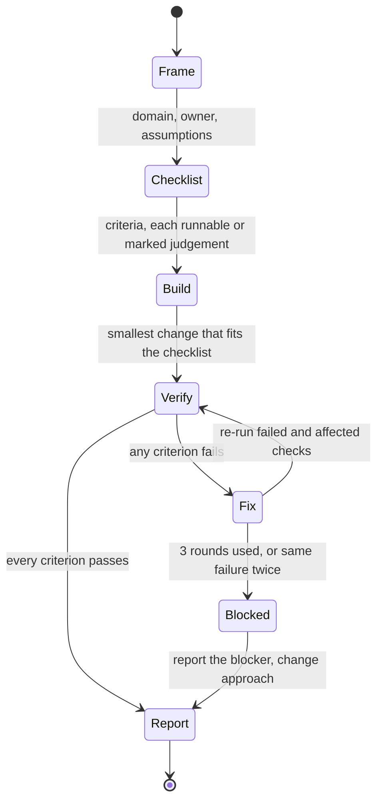
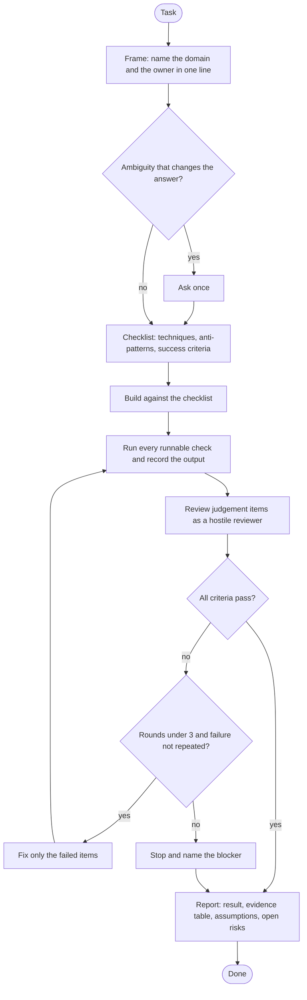

# expert-loop

A skill for better answers from AI: frame the task in its domain, build a runnable
checklist, build, verify against real checks, fix, and report gaps.

The animation walks one sample task through each state, one at a time, including a failed check and a fix round.

## Install (all your projects)

    claude plugin marketplace add radeshgovind-2005/expert-loop
    claude plugin install expert-loop@expert-loop

Or copy the skill: `cp -r skills/expert-loop ~/.claude/skills/`

## Use

Say "expert loop" before a task, or invoke `/expert-loop`.

## How the loop works

### State machine

Each state has one job. Only a real check result moves the loop from Verify to Report.

### Flowchart

## Why it is built this way

- Persona prompts alone do not reliably improve accuracy (Wharton "Playing Pretend", 2025;
  Zheng et al., EMNLP 2024). The persona is one line. The checklist does the work.
- Models self-correct poorly without outside signal (Huang et al., ICLR 2024). Verification
  runs real checks first and treats self-review as a fallback.
- Related: Self-Refine, Chain-of-Verification, Reflexion, evaluator-optimizer, Ralph loops.
